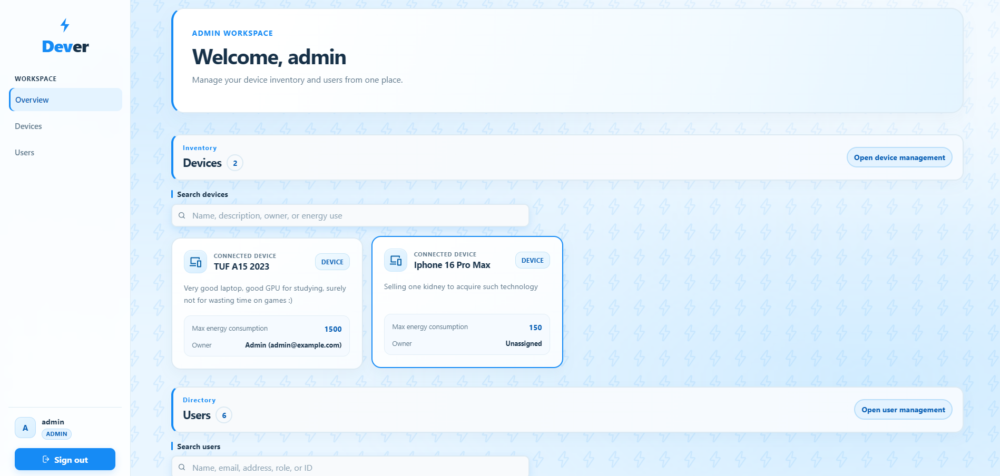
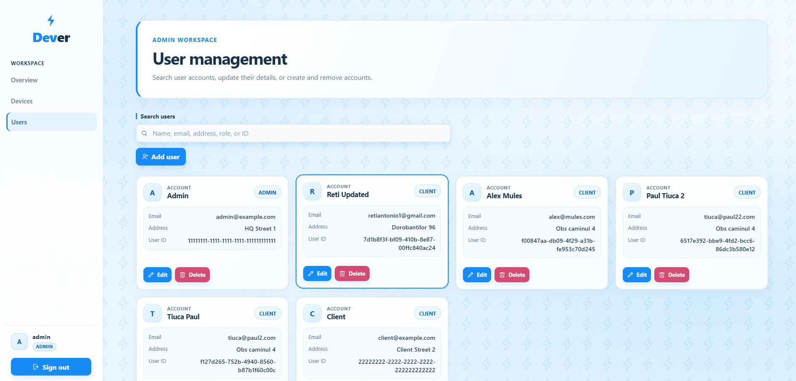
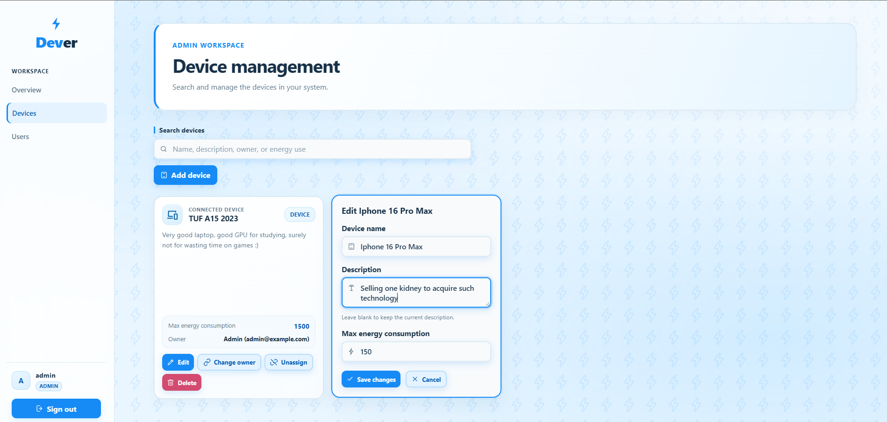
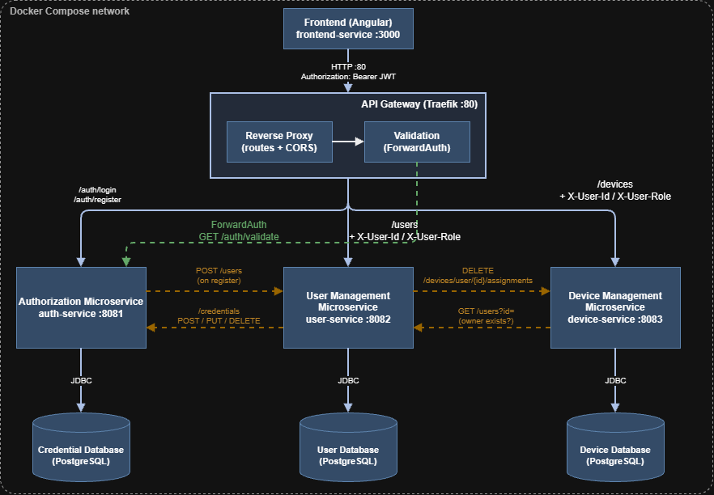

# Energy Management Microservices

A small distributed system for managing **users** and their **devices**, built with Spring Boot microservices behind a Traefik API gateway. Authentication is JWT-based, and each service owns its own PostgreSQL database. An **Angular website** (`frontend-service`) covers all of the back-end endpoints, so every feature can be used from the browser.

## Screenshots

<div align="center">
  <table>
    <tr>
      <td align="center">
        
        <br />
        <strong>Login</strong>
      </td>
      <td align="center">
        
        <br />
        <strong>Dashboard</strong>
      </td>
    </tr>
    <tr>
      <td align="center">
        
        <br />
        <strong>Users</strong>
      </td>
      <td align="center">
        
        <br />
        <strong>Devices</strong>
      </td>
    </tr>
  </table>
</div>

## Deployment Diagram

<p align="center">
  
</p>

## Architecture

| Component | Port (internal) | Responsibility |
|---|---|---|
| **Traefik** (API gateway) | 80 | Single public entry point. Serves the website at `/` and the API under `/api` (the prefix is stripped before forwarding). Validates JWTs through ForwardAuth before `/api/users` and `/api/devices` calls reach the services. |
| **frontend-service** (Angular) | 80 | The website. Lets users register, log in and use every user and device endpoint through the gateway. |
| **auth-service** | 8081 | Register, login, JWT issuing and validation. Stores credentials (`credential-db`). |
| **user-service** | 8082 | User profile CRUD (clients and admins). Stores profiles (`user-db`). |
| **device-service** | 8083 | Device CRUD and device-to-user assignment. Stores devices (`device-db`). |

How the services talk to each other:

- **Browser → Traefik:** the website is served from `http://localhost`, and its API calls go to `http://localhost/api/...` on the same origin.
- **Traefik → service:** for `/api/users` and `/api/devices`, Traefik first calls `auth-service` (`GET /auth/validate`) and forwards the user's id and role as `X-User-Id` / `X-User-Role` headers.
- **auth-service → user-service:** `POST /users` when someone registers.
- **user-service → auth-service:** `POST / PUT / DELETE /credentials` when a user is created, updated or deleted.
- **user-service → device-service:** `DELETE /devices/user/{id}/assignments` when a user is deleted.
- **device-service → user-service:** `GET /users?id=` to check that an owner exists before assigning a device.

Service-to-service calls use the `X-Internal-Key` header and are only possible inside the Docker network.

Roles: `ADMIN` (full access), `CLIENT` (can only see their own profile and devices).

## Prerequisites

- Docker and Docker Compose

## User manual

### 1. Clone the repository

```bash
git clone <your-repo-url>
cd <repo-folder>
```

### 2. Create the `.env` file

In the repository root (next to `docker-compose.yml`), create a file named `.env` with two values:

```env
JWT_SECRET=replace-with-a-long-random-string-at-least-32-characters
INTERNAL_API_KEY=replace-with-another-random-string
```

- `JWT_SECRET` signs the JWT tokens (use at least 32 characters).
- `INTERNAL_API_KEY` authenticates service-to-service calls. All services read the same value.

`.env` is git-ignored, so your secrets are never committed.

### 3. Build and start everything

```bash
docker compose up -d --build
```

This builds the frontend and the three services, and starts the three databases and Traefik. Wait until all containers are up:

```bash
docker compose ps
```

### 4. Use the application

Open **http://localhost** in your browser (no port needed). This is the Angular website. Register a client account or log in, then use the user and device pages. Admins can manage everything; clients only see their own profile and devices.

The first admin account is created by the database seed script. Log in with that admin's username and password to create other users and devices.

The API behind the website is available at **http://localhost/api**, for example:

- `POST http://localhost/api/auth/register`: create a client account
- `POST http://localhost/api/auth/login`: get a JWT
- `GET http://localhost/api/users` and `GET http://localhost/api/devices`: send `Authorization: Bearer <token>`

The Traefik dashboard (development only) is at http://localhost:8080.

### 5. Explore the endpoints with Swagger (local only)

Each back-end service has its own Swagger UI for studying and trying the endpoints. Swagger is **not** exposed through Traefik. It is only reachable from your own machine, because the compose file binds the service ports to `127.0.0.1`:

| Service | Swagger UI |
|---|---|
| auth-service | http://localhost:8081/swagger-ui/index.html |
| user-service | http://localhost:8082/swagger-ui/index.html |
| device-service | http://localhost:8083/swagger-ui/index.html |

Calls from Swagger bypass Traefik, so a JWT is not used there. Click **Authorize** and fill in `X-User-Id` and `X-User-Role` (for example `ADMIN`) to simulate what the gateway normally injects.

> For a real deployment, remove the `ports:` entries of the services and databases in `docker-compose.yml`. Anyone who could reach those ports could skip the gateway's JWT check.

### 6. Stop the application

```bash
docker compose down        # stop containers, keep database data
docker compose down -v     # stop containers and delete database data
```

## Project structure

```
.
├── authentication-service/   # auth-service (Spring Boot)
├── user-service/             # user-service (Spring Boot)
├── device-service/           # device-service (Spring Boot)
├── frontend-service/         # Angular website
├── db/                       # database images and seed scripts
├── docker-compose.yml
├── .env                      # not committed
└── README.md
```